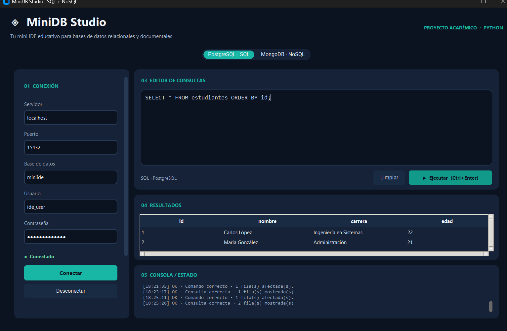
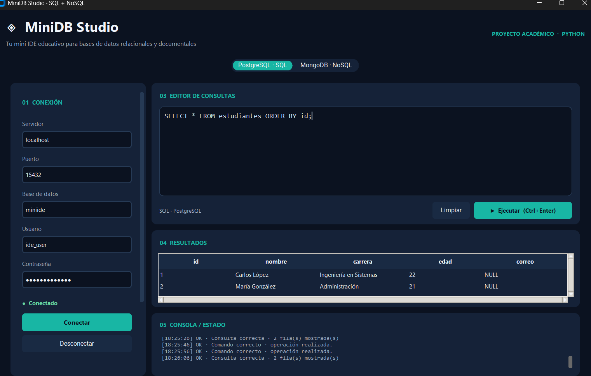
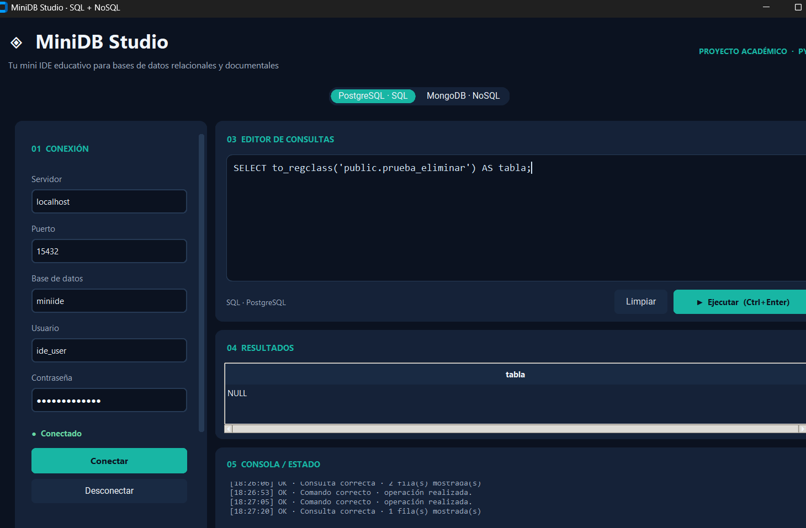
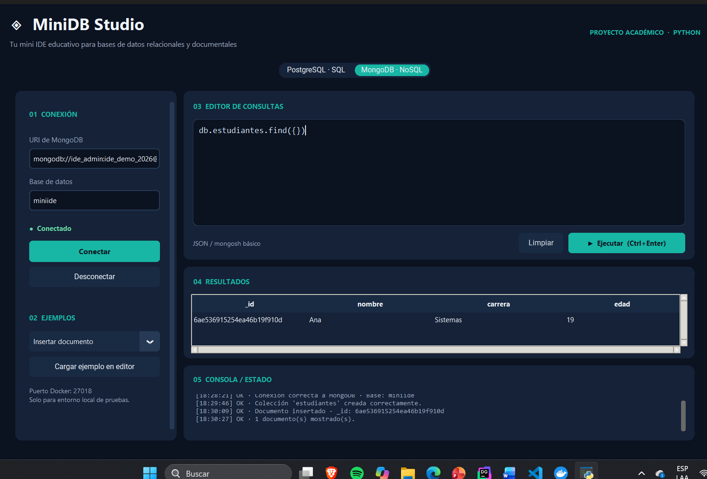
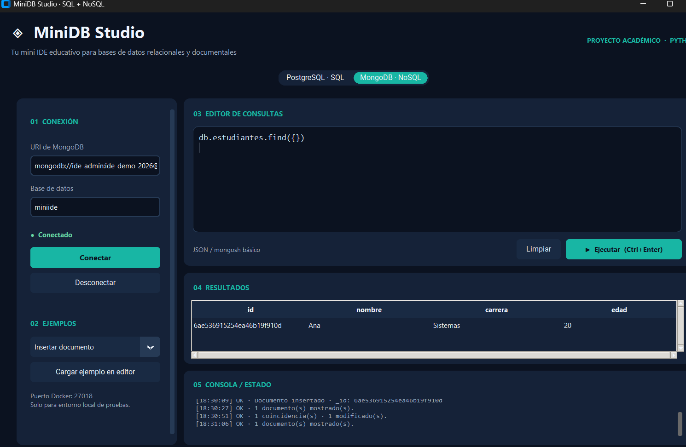
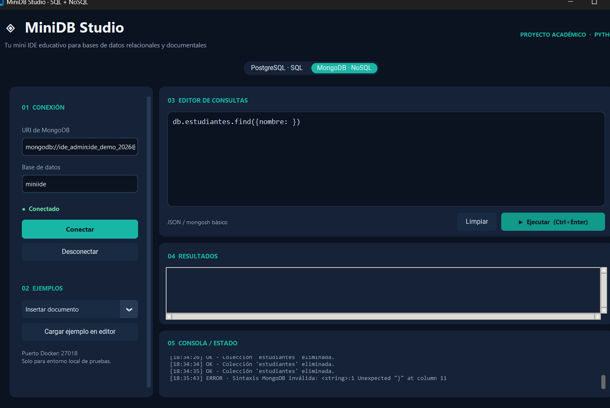

# MiniDB Studio

**Gabriel Estuardo Polero Benavente**
**Carné:** 2890-24-8909
**Curso:** Bases de Datos

## Descripción

MiniDB Studio es una aplicación de escritorio para realizar consultas en dos gestores de bases de datos: PostgreSQL (relacional) y MongoDB (documental). La interfaz permite establecer conexiones, escribir y ejecutar comandos, observar resultados en tablas y consultar mensajes de estado o error.

El objetivo es utilizar una sola interfaz para comparar operaciones sobre tablas SQL y colecciones de documentos NoSQL.

## Tecnologías

| Herramienta | Uso |
| --- | --- |
| Python | Lógica de ejecución y coordinación de la interfaz |
| CustomTkinter | Interfaz gráfica |
| psycopg 3 | Acceso a PostgreSQL |
| PyMongo 4 | Acceso a MongoDB |
| json5 | Lectura de argumentos en los comandos MongoDB admitidos |
| sqlparse | Análisis básico de sentencias SQL |
| python-dotenv | Configuración local opcional |
| Docker Compose | Inicio de los dos motores para pruebas locales |

Se utilizó **PostgreSQL 17** (en las pruebas se registró **17.11**) y la imagen **MongoDB 8.0**. Las versiones exactas instaladas se pueden consultar mediante `scripts/diagnostico.py`.

## Requisitos

- Windows con Python 3 instalado y VS Code (recomendado).
- Docker Desktop iniciado y funcionando.
- Conexión a Internet durante la primera descarga de las dependencias e imágenes.

También es posible ejecutar el programa en Linux y macOS con Python y Docker.

## Instalación en Windows

Abrir la carpeta `mini-ide-sql-nosql` en VS Code y ejecutar los comandos en una terminal PowerShell, dentro de esa carpeta.

1. Iniciar los contenedores:

   ```powershell
   docker compose up -d
   docker compose ps
   ```

2. Crear el entorno virtual e instalar las librerías:

   ```powershell
   py -3 -m venv .venv
   .\.venv\Scripts\python.exe -m pip install -r requirements.txt
   ```

3. Iniciar la aplicación:

   ```powershell
   .\.venv\Scripts\python.exe main.py
   ```

Para abrirla otro día, iniciar Docker Desktop, ejecutar `docker compose up -d` y lanzar `main.py`; no es necesario reinstalar las librerías.

También se incluye `iniciar_windows.bat` como alternativa para iniciar el entorno local.

### Conexiones locales

| Parámetro | PostgreSQL | MongoDB |
| --- | --- | --- |
| Servidor | `localhost` | `localhost` |
| Puerto de la computadora | `15432` | `27018` |
| Base de datos | `miniide` | `miniide` |
| Usuario | `ide_user` | `ide_admin` |

Las contraseñas de **demostración local** figuran en `docker-compose.yml`. La aplicación muestra la configuración de ejemplo al abrirse. No se deben reutilizar esas credenciales en servicios públicos o entornos de producción.

**Nota:** los puertos indicados son puertos de la computadora. Dentro de los contenedores, PostgreSQL utiliza `5432` y MongoDB `27017`. El puerto externo de PostgreSQL se configuró en `15432` para evitar un conflicto con otra instancia local.

Si otro servicio ocupa uno de estos puertos, cambiar el puerto del lado izquierdo de la asignación en `docker-compose.yml` y actualizar el campo correspondiente en la aplicación. Las variables de `.env.example` permiten personalizar los valores predeterminados de la interfaz copiándolas a un archivo `.env` local. El archivo `.env` no debe subirse a GitHub.

### Diagnóstico

```powershell
.\.venv\Scripts\python.exe scripts/diagnostico.py
```

El diagnóstico verifica la conectividad de ambos motores y muestra las versiones que responden.

## Uso de la interfaz

1. Elegir la pestaña **PostgreSQL · SQL** o **MongoDB · NoSQL**.
2. Revisar la conexión y pulsar **Conectar**.
3. Escribir un comando o seleccionar uno del menú **Ejemplos** y pulsar **Cargar ejemplo en editor**.
4. Pulsar **Ejecutar** o **Ctrl+Enter**.
5. Revisar la tabla de resultados y los mensajes de la consola.

La tabla muestra un máximo de 500 filas o documentos por consulta. El área SQL admite instrucciones DDL y DML. En MongoDB se admiten operaciones JSON y un subconjunto explícito de comandos con forma `db.coleccion.metodo(...)`; **no es un intérprete JavaScript completo**.

### Ejemplos SQL

Crear estructura (DDL):

```sql
CREATE TABLE IF NOT EXISTS estudiantes (
    id SERIAL PRIMARY KEY,
    nombre VARCHAR(100),
    carrera VARCHAR(100),
    edad INTEGER
);
```

Insertar registros (DML):

```sql
INSERT INTO estudiantes (nombre, carrera, edad) VALUES
('Carlos López', 'Ingeniería en Sistemas', 20),
('María González', 'Administración', 21),
('Ana Martínez', 'Ingeniería Industrial', 19);
```

Consultar:

```sql
SELECT * FROM estudiantes ORDER BY id;
```

Actualizar y eliminar registros:

```sql
UPDATE estudiantes SET edad = 22 WHERE id = 1;
DELETE FROM estudiantes WHERE nombre = 'Ana Martínez';
```

Modificar estructura (DDL):

```sql
ALTER TABLE estudiantes ADD COLUMN IF NOT EXISTS correo VARCHAR(150);
```

Para probar la eliminación de una tabla sin afectar `estudiantes`:

```sql
CREATE TABLE prueba_eliminar (id SERIAL PRIMARY KEY, descripcion VARCHAR(100));
DROP TABLE prueba_eliminar;
SELECT to_regclass('public.prueba_eliminar') AS tabla;
```

El resultado de la última consulta es `NULL` cuando la tabla auxiliar ya no existe.

### Ejemplos MongoDB

Crear colección:

```javascript
db.createCollection("estudiantes")
```

Insertar y consultar documentos:

```javascript
db.estudiantes.insertOne({nombre: "Ana", carrera: "Sistemas", edad: 19})
db.estudiantes.find({})
```

Actualizar y eliminar documentos:

```javascript
db.estudiantes.updateOne({nombre: "Ana"}, {$set: {edad: 20}})
db.estudiantes.deleteOne({nombre: "Ana"})
```

Eliminar colección:

```javascript
db.estudiantes.drop()
```

**Nota:** ejecutar **una operación MongoDB por vez**. El editor admite además JSON, por ejemplo:

```json
{"operation": "find", "collection": "estudiantes", "filter": {}, "limit": 50}
```

Operaciones disponibles: creación, listado y eliminación de colecciones; inserción, búsqueda, actualización y eliminación de documentos; conteo y administración básica de índices. Para más ejemplos, consultar `examples/`.

## Estructura del proyecto

```text
mini-ide-sql-nosql/
├── app/
│   ├── gui.py              # Interfaz y eventos
│   ├── sql_manager.py      # Conexión y operaciones SQL
│   ├── nosql_manager.py    # Conexión y operaciones MongoDB
│   └── result_manager.py   # Formato de resultados
├── docs/capturas/          # Evidencias de ejecución
├── examples/               # Comandos para pruebas
├── scripts/diagnostico.py  # Verificación de conexiones
├── tests/                  # Pruebas unitarias
├── docker-compose.yml
├── main.py
├── requirements.txt
└── README.md
```

**Flujo general:** interfaz gráfica → módulo SQL o NoSQL → motor de base de datos → resultado → tabla y consola.

Las conexiones y las consultas se ejecutan mediante una tarea de trabajo separada de los controles gráficos. Para PostgreSQL se gestionan transacciones y se revierten los cambios de una operación fallida.

## Pruebas realizadas

Las operaciones siguientes se comprobaron con los gestores funcionando localmente:

| Área | Verificación |
| --- | --- |
| PostgreSQL | Conexión, `CREATE TABLE`, `ALTER TABLE`, `DROP TABLE` |
| PostgreSQL | `INSERT`, `SELECT`, `UPDATE`, `DELETE` y visualización de filas |
| MongoDB | Conexión, `createCollection()`, `drop()` |
| MongoDB | `insertOne()`, `find()`, `updateOne()`, `deleteOne()` |
| Manejo de errores | Aviso por sintaxis MongoDB inválida y ejecución de una consulta correcta a continuación |

Las pruebas de las operaciones adicionales disponibles en el editor pueden repetirse con los comandos de `examples/`.

Para ejecutar las pruebas unitarias:

```powershell
.\.venv\Scripts\python.exe -m pip install pytest
.\.venv\Scripts\python.exe -m pytest -q
```

### Capturas

**Consulta SQL:**



**Modificación de estructura:**



**Eliminación de tabla auxiliar:**



**MongoDB — consulta de documentos:**



**MongoDB — actualización:**



**Manejo de errores:**



## Dificultades y aprendizaje

Durante las pruebas encontré algunos inconvenientes al configurar el entorno local. Docker estaba instalado, pero inicialmente su motor no estaba iniciado. También hubo un conflicto con el puerto habitual que se había elegido para PostgreSQL, así que cambié el puerto externo a `15432` y confirmé la conexión con el gestor desde la aplicación. Trabajar con ambos motores me ayudó a distinguir el uso de tablas y sentencias SQL frente a las colecciones y documentos de MongoDB. La prueba de errores también mostró por qué es importante validar los comandos sin cerrar la aplicación.

## Problemas frecuentes

| Problema | Comprobación |
| --- | --- |
| Docker no se conecta | Abrir Docker Desktop y esperar que inicie el motor. |
| El puerto está ocupado | Revisar `docker compose ps`; cambiar solo el puerto del host y el puerto de conexión de la aplicación. |
| Error de contraseña | Comparar con los datos del archivo `docker-compose.yml`. |
| Tabla SQL inexistente | Ejecutar `CREATE TABLE` antes de `SELECT`. |
| Colección ya creada | Continuar con inserción o utilizar otro nombre. |
| Error en un comando MongoDB | Revisar la sintaxis y usar solo operaciones admitidas por el editor. |

Detener los contenedores sin perder los volúmenes:

```powershell
docker compose down
```

**Precaución:** `docker compose down -v` elimina también los volúmenes de datos del proyecto. No ejecutarlo si se desea conservar la información.
